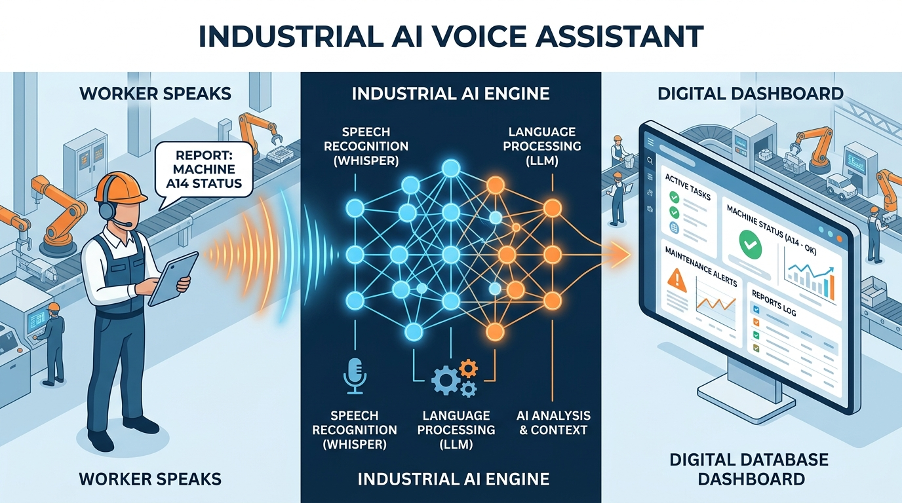
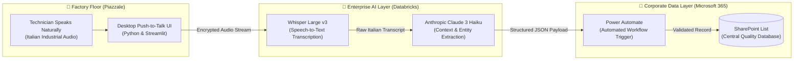

  

# 🏭 Industrial AI Voice Assistant — Enterprise Architecture Case Study

> 🔒 **Corporate Security & Non-Disclosure Notice:**  
> Due to strict Non-Disclosure Agreements (NDA) and enterprise cybersecurity policies, **zero source code, internal credentials, or proprietary schemas** are stored in this repository. This document serves strictly as a high-level architectural case study explaining the operational challenge, the AI pipeline design, the tools selected, and the business value delivered.

---

## 📋 Executive Summary

| Dimension | Details |
| :--- | :--- |
| **Industry Sector** | Automotive Manufacturing & Quality Operations (EV Production Line) |
| **Role** | Cloud & AI Application Engineer |
| **Core Objective** | Eliminate manual defect data-entry bottlenecks on the factory repair floor (*Piazzale*) using hands-free Voice AI |
| **Primary Outcome** | Reduced defect reporting time by **~80% (from ~5 minutes to ~1 minute per vehicle defect)** while enforcing standardized database entries |

---

## 📌 1. The Operational Challenge

On the electric vehicle production and repair floor (*Piazzale*), specialized electricians diagnose and resolve complex vehicle defects under tight production timelines. Previously, reporting each defect required a disruptive manual workflow:

1. **Physical Interruption:** Stopping repair work, removing protective gloves, and walking to a shared workstation.
2. **Manual Form Navigation:** Navigating multi-field web forms and drop-down menus in Microsoft SharePoint.
3. **Inconsistent Terminology:** Typing free-text descriptions in noisy industrial environments led to inconsistent acronyms and classification errors.

This manual process consumed **approximately 5 minutes per defect**, pulling skilled technicians away from high-value diagnostics and creating a bottleneck in quality tracking.

---

## 🏗️ 2. End-to-End System Architecture

To solve this without requiring workers to type or navigate complex menus, I designed a **hands-free, voice-driven AI pipeline** deployed entirely within the company's approved enterprise cloud boundaries:

### How the Pipeline Works Step-by-Step:
1. **Hands-Free Audio Capture:** The technician presses a single push-to-talk button on a streamlined desktop interface and describes the vehicle issue naturally in Italian (including factory-specific jargon and sequence numbers).
2. **Industrial Speech Recognition (`Whisper Large v3`):** The captured audio is transmitted securely to an enterprise **Databricks** serving endpoint running **Whisper Large v3**, which accurately transcribes noisy factory-floor speech into text.
3. **Intelligent Entity Extraction (`Claude 3 Haiku`):** A second Databricks endpoint invokes **Anthropic Claude 3 Haiku** with domain-specific instructions. The LLM parses the natural-language transcript and extracts structured fields—such as *Vehicle Sequence*, *Component Category (Tipologia)*, and *Defect Description*—into a clean, validated structure.
4. **Human-in-the-Loop Confirmation & Automated Sync:** The technician visually verifies the extracted fields on screen in seconds. Upon confirmation, **Microsoft Power Automate** automatically writes the standardized record directly into the corporate **SharePoint List**.

---

## 🛠️ 3. Technology Stack & Tooling Rationale

| Layer | Tool / Platform | Why It Was Chosen & Engineering Role |
| :--- | :--- | :--- |
| **User Interface** | **Python & Streamlit** | Provided a clean, responsive push-to-talk web/desktop interface packaged with a one-click launcher so factory technicians never interact with terminals or complex forms. |
| **Enterprise AI Hosting** | **Databricks Model Serving** | Ensured all audio and text processing remained strictly inside enterprise-governed cloud infrastructure, satisfying corporate data-privacy and security compliance. |
| **Speech-to-Text (STT)** | **Whisper Large v3** | Delivered superior multilingual (Italian) transcription accuracy even in high-noise manufacturing environments with technical automotive vocabulary. |
| **Natural Language Understanding** | **Anthropic Claude 3 Haiku** | Chosen for ultra-low latency and high reliability in converting unstructured spoken sentences into deterministic, categorized defect records. |
| **Workflow & Database** | **Power Automate & SharePoint** | Seamlessly integrated with the organization's existing Microsoft 365 ecosystem without requiring custom database maintenance from factory IT staff. |

---

## 📊 4. Measurable Business Impact

| Operational Metric | Before (Manual Entry) | After (Voice AI Platform) | Impact / Improvement |
| :--- | :--- | :--- | :--- |
| **Time per Defect Report** | ~5 minutes | **~1 minute** | **-80% reduction** in administrative time |
| **Technician Workflow** | Remove gloves, walk to PC, type & search menus | **Speak naturally & click once** | Hands-free ergonomics on the repair floor |
| **Data Standardization** | Free-text typos & inconsistent categories | **LLM-normalized fields & categories** | Higher downstream analytics & reporting quality |
| **IT & Security Compliance** | Manual browser sessions | **100% private Databricks & M365 pipeline** | Zero external data leakage |

---

*Architected and developed by [Iman Moradi Nezhad](https://github.com/ImanMrd) — Cloud, DevOps & AI Engineer.*
